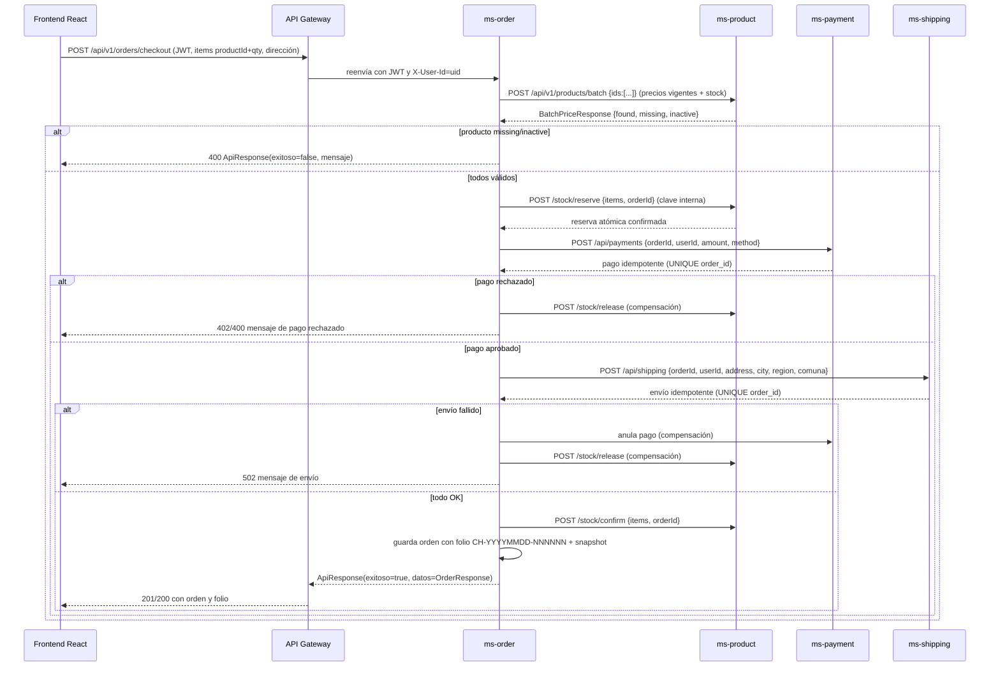

# Guía de integración Frontend ↔ Backend

Esta guía describe el contrato real entre el frontend React (`frontend-react/`) y los microservicios Spring Boot, después de la limpieza de arquitectura. Toda la documentación anterior que mencionaba Kafka, `guest_id`, `ms-inventory`, `ms-review`, `ms-notification`, `ms-analytics` o precios enviados por el cliente quedó obsoleta.

## 1. Arquitectura y principios

- **8 servicios** desplegados: `api-gateway`, `eureka`, `ms-auth`, `ms-product`, `ms-cart`, `ms-order`, `ms-payment`, `ms-shipping` y `ms-content`. Eureka + Gateway + 7 servicios de negocio.
- **Sin Kafka.** Toda la comunicación es HTTP síncrona vía OpenFeign con descubrimiento Eureka.
- **Sin compra de invitado.** Toda operación de carrito/orden/pago exige sesión. El carrito anónimo vive solo en `localStorage` (`chic_carrito_pendiente`) y se fusiona al iniciar sesión.
- **El cliente nunca envía precios.** Envía solo `productId` + `quantity`; el backend consulta precios vigentes en `ms-product`.
- **Identidad unificada.** `user_id` = `uid` (id numérico del usuario en `ms-auth`), propagado en el JWT y en las llamadas Feign. `product_id` = UUID con `sku` denormalizado en orden/carrito.
- **Esquema en inglés, UI en español.** `init-multi-db/` es la única fuente del esquema; `ddl-auto: validate`.
- **Sobre de respuesta** `ApiResponse<T>`: `{ "exitoso": boolean, "datos": T, "mensaje": string|null, "timestamp": string }`. Errores usan el mismo sobre con `exitoso: false` y `mensaje` descriptivo.

### Puertos y entorno

| Recurso | Valor |
|---|---|
| Gateway | `http://localhost:9000` |
| Eureka | `http://localhost:8761` |
| PostgreSQL | `localhost:5433`, usuario `postgres`, password `123` |
| Frontend dev | `VITE_API_URL` (por defecto `http://localhost:9000`) |

Swagger UI y `/actuator/health` son públicos; el resto de endpoints exige `Authorization: Bearer <jwt>`, salvo los marcados como públicos.

## 2. Mapa endpoint → servicio → rol

| Método y ruta | Servicio | Acceso |
|---|---|---|
| `POST /api/v1/auth/register`, `POST /api/v1/auth/login` | ms-auth | Público |
| `POST /api/v1/auth/admin/register` | ms-auth | ADMIN |
| `GET/PUT /api/v1/auth/me` | ms-auth | Autenticado (self) |
| `GET /api/v1/regions`, `GET /api/v1/comunas`, `GET /api/v1/roles` | ms-auth | Público |
| `GET /api/v1/users`, `GET/PUT/DELETE /api/v1/users/{id}` | ms-auth | ADMIN |
| `GET /api/v1/products/**`, `POST /api/v1/products/batch` | ms-product | Público |
| `POST /api/v1/products`, `PUT/DELETE /api/v1/products/{id}` | ms-product | ADMIN o SELLER |
| `POST /api/v1/products/stock/{reserve,confirm,release,restore}` | ms-product | Solo servicios (clave interna `X-Internal-Key`) |
| `GET /api/v1/categories/**` | ms-product | Público |
| `POST/PUT/DELETE /api/v1/categories/**` | ms-product | ADMIN |
| `GET/POST/DELETE /api/v1/favorites/**` | ms-product | Autenticado (self) |
| `GET /api/v1/cart/{uid}`, items y `merge` | ms-cart | Autenticado (self o ADMIN) |
| `POST /api/v1/orders`, `POST /api/v1/orders/checkout` | ms-order | Autenticado |
| `GET /api/v1/orders/user/{uid}` | ms-order | Autenticado (self o ADMIN) |
| `GET /api/v1/orders`, `GET /api/v1/orders/stats` | ms-order | ADMIN o SELLER |
| `GET /api/v1/orders/{id}`, `PUT .../cancel`, `PUT .../status` | ms-order | Autenticado / ADMIN-SELLER según operación |
| `POST/GET /api/payments/**` | ms-payment | Autenticado |
| `POST/GET/PUT /api/shipping/**` | ms-shipping | Autenticado |
| `GET /api/v1/news/**`, `POST /api/v1/contact` | ms-content | Público |
| `GET /api/v1/contact` | ms-content | ADMIN |

## 3. Flujo de checkout (diagrama de secuencia)

El endpoint `POST /api/v1/orders/checkout` en `ms-order` es el orquestador. Si un paso falla, ejecuta compensaciones en orden inverso (libera stock reservado, cancela pago, cancela envío).

### Reglas del checkout

- El **folio** `CH-YYYYMMDD-NNNNNN` se genera con `order_folio_seq` (secuencia atómica en PostgreSQL).
- La orden guarda **snapshot** del cliente y envío (no referencias vivas): nombre, dirección, comuna, teléfono.
- `order_items` guarda `product_id UUID`, `sku`, `unit_price` y `line_total` al momento de la compra.
- Idempotencia de pago y envío: `@Column(unique = true)` en `order_id`. Reintentos con el mismo `orderId` devuelven el registro existente.
- Reserva de stock atómica en `ms-product` (predicado SQL con `available >= quantity`).
- **Sin mensajería:** si `ms-payment` o `ms-shipping` caen, la orden no queda en estado inconsistente gracias a las compensaciones síncronas.

### ¿Por qué REST síncrono y no mensajería?

 Se descartó Kafka deliberadamente para esta versión:
- El checkout es una transacción de usuario que espera respuesta inmediata; con eventos habría que explicar estados eventuales (PENDING → PAID) en la UI y gestionar idempotencia/reintentos en cada consumidor.
- Con 7 servicios de negocio y un solo flujo de compra, la complejidad operativa de brokers, topics, particiones y consumer groups superaba el beneficio.
- Feign + Eureka dan acoplamiento temporal, pero compensaciones explícitas y `UNIQUE(order_id)` cubren la consistencia necesaria con un modelo más simple de probar y desplegar.
- La puerta de entrada es el API Gateway; Swagger y health checks permiten verificar cada servicio de forma independiente.

## 4. Autenticación en el frontend

1. `POST /api/v1/auth/login` devuelve `{ token, usuario, rol }` dentro de `datos`.
2. `auth.ts` guarda el JWT en `localStorage` (`chic_token`) y la sesión serializada en `chic_sesion`.
3. `client.ts` añade `Authorization: Bearer <token>` a cada petición; si recibe `401`, limpia la sesión y lanza `ApiError`.
4. `AuthContext.tsx` rehidrata la sesión al cargar con `GET /api/v1/auth/me`.
5. Roles: `ADMIN` (todo), `SELLER` (productos y órdenes), `CUSTOMER` (compras y datos propios).
6. Rutas protegidas: el frontend esconde UI por rol, pero **la autoridad real está en los `@PreAuthorize` del backend**.

## 5. Carrito anónimo → sesión

- Sin sesión, el carrito se guarda en `localStorage` (`chic_carrito_pendiente`) como `[{ productId, quantity }]` (UUIDs como string).
- Al iniciar sesión, `CartContext` envía `POST /api/v1/cart/{uid}/merge` con esa lista.
- `ms-cart` consulta `ms-product` para validar precios y `available`, suma cantidades para productos repetidos y recorta al stock disponible.
- Después del merge se limpia `chic_carrito_pendiente`.

## 6. Errores y códigos

| Código | Significado |
|---|---|
| 400 | Validación o error de negocio (stock insuficiente, producto inactivo) |
| 401 | Token ausente/inválido → el frontend cierra sesión |
| 403 | Rol insuficiente o ruta interna sin clave |
| 404 | Recurso inexistente |
| 409 | Conflicto (ej. pago duplicado, categoría con productos) |
| 500 | Error no controlado; reportar con el `timestamp` del `ApiResponse` |

## 7. Colección Postman

`postman/Accesorios-Chic.postman_collection.json` contiene todas las llamadas agrupadas por dominio. El primer request (`Auth → Login`) guarda automáticamente el JWT y el `uid` en variables de colección; el resto los reutiliza. Flujo sugerido:

1. Login con `camila@gmail.com` / `cliente1` (CUSTOMER) o `admin@gmail.com` / `admin123` (ADMIN).
2. Catálogo → detalle de producto (guarda `productId`) → categorías.
3. Carrito → agregar item → merge.
4. Checkout (guarda `folio`) → mis órdenes → pago → envío.
5. Contenido → noticias, mensaje de contacto.

## 8. Pruebas

- Backend: `mvn -o -pl common,ms-auth,ms-product,ms-cart,ms-order,ms-payment,ms-shipping,ms-content -am -Dsurefire.failIfNoSpecifiedTests=false test`
- Frontend: `cd frontend-react && npm test -- --run && npm run build && npm run lint`
